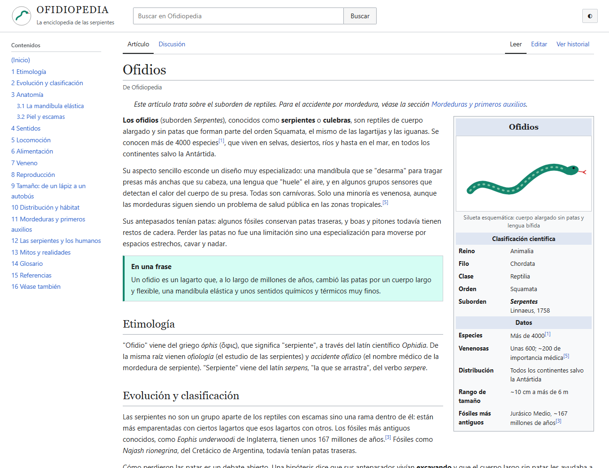

# encyclopedia-page

A skill for Claude that turns **any topic** into a single, self-contained HTML page laid out like an encyclopedia article, written so a non-expert can follow it.

Ask "make me a page about *ofidio*", "explain the Ricci tensor as an encyclopedia article" or "página estilo enciclopedia sobre la fotosíntesis". You get one HTML file that includes:

- a header with a fictional "-pedia" brand, a numbered and sticky table of contents, and tabs;
- an infobox (taxobox, formula card, dates card…) with an SVG illustration;
- a lead, an "in one sentence" box, and sections chosen for the topic type;
- analogies, inline SVG figures drawn for the topic, and tables;
- optional calculators or plots, and hidden spoilers for exercises;
- ⚠️ boxes for myths, pitfalls and errata;
- a glossary, real references, see-also links, a navbox and categories;
- KaTeX math, dark mode, a mobile layout, and an interface in es / en / pt / fr.



Complete example: [`skills/encyclopedia-page/examples/ofidio.html`](skills/encyclopedia-page/examples/ofidio.html). Download it and open it in a browser.

## Install

**Claude Code (plugin marketplace)**

```
/plugin marketplace add bnbuitragom/encyclopedia-page-skill
/plugin install encyclopedia-page@encyclopedia-page
```

**Claude Code (manual)**

```bash
git clone https://github.com/bnbuitragom/encyclopedia-page-skill
cp -r encyclopedia-page-skill/skills/encyclopedia-page ~/.claude/skills/
```

**Claude.ai / Claude desktop**: download `encyclopedia-page.zip` from the [latest release](https://github.com/bnbuitragom/encyclopedia-page-skill/releases/latest) and upload it under *Settings → Capabilities → Skills*.

## How it works

| Part | Role |
|---|---|
| `SKILL.md` | Workflow: understand the topic and the reader, verify facts, plan sections, build, check the rendering, deliver |
| `references/topic-patterns.md` | Section plans for concepts, equations or homework, organisms, people, places, events, technology and works |
| `references/components.md` | Copy-ready snippets: infobox, boxes, math, tables, SVG figures, spoilers, calculators, navbox |
| `assets/template.html` | The page shell: styles, automatic table of contents, localization, dark mode, KaTeX |
| `scripts/assemble.py` | Combines template + article fragment + optional script and logo into the final page |
| `scripts/screenshot.sh` | Headless Chrome, Chromium or Edge screenshot so Claude can check the page (Linux, macOS, WSL) |

The skill requires that every number and formula be recomputed, that references be real, and that every figure be visually checked before the page is delivered.

## Name and trademark

"Wikipedia" and its puzzle-globe logo are trademarks of the Wikimedia Foundation. This project is **not affiliated with or endorsed by** the Wikimedia Foundation. Generated pages use a fictional brand ending in "-pedia" (e.g. *Ofidiopedia*, *Orbipedia*) and an original logo, include a non-affiliation footer, and `assemble.py` refuses brands containing "Wikipedia". Please keep it that way if you fork.

---

### En español

Skill para Claude que convierte **cualquier tema** en una página HTML con aspecto de artículo de enciclopedia, pensada para que alguien no experto entienda el tema. Incluye ficha lateral, índice, figuras SVG hechas para el tema, analogías, cajas de mitos y erratas, glosario y referencias verificables. Para instalarla, usa los comandos de arriba y luego pide, por ejemplo: *"hazme una página estilo enciclopedia sobre ofidio"*.

License: MIT.
